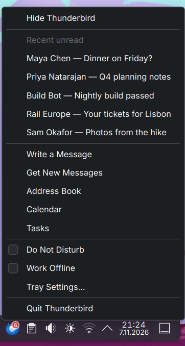
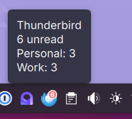
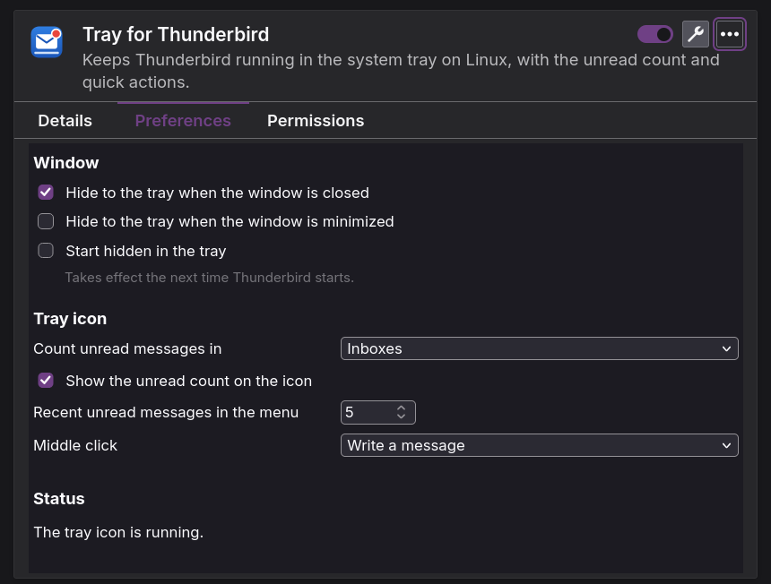

# Tray for Thunderbird

[Türkçe](README.tr.md)

Keeps Thunderbird running in the system tray on Linux. Close the window and Thunderbird hides instead of
quitting, so new mail keeps arriving and notifications keep showing. The tray icon shows how much mail
is waiting and puts the things you do most one click away.

Thunderbird has this built in only on Windows. Tray for Thunderbird brings it to Linux, Wayland included,
without forcing Thunderbird onto X11.

<p>
  
  
</p>

## Features

- **Hide instead of quit.** Closing the main window, and optionally minimizing it, hides it to the tray.
  A click on the icon brings it back, focused. Quitting from the menu, or with Ctrl+Q, quits for real.
- **Unread count** on the icon, for inboxes or for all folders.
- **Tooltip** with the unread and new mail per account, a warning when a mailbox is over 80% full,
  and whether you are offline or have alerts turned off.
- **Recent unread mail** in the menu: sender and subject of the newest messages, opened with one click.
- **Quick actions:** write a message, get new messages, address book, calendar, tasks.
- **Do Not Disturb** turns Thunderbird's new mail alerts off and on. **Work Offline** from the tray.
- **Middle click** writes a message or gets new mail, as you choose.
- **Start hidden** when Thunderbird starts, for example at login.
- Follows Thunderbird's language. English and Turkish are included.

## How it works

Two parts work together: a Thunderbird add-on, which counts mail and hides the window, and a small tray
program, which Thunderbird starts and stops itself through native messaging. Windows are hidden only
while the tray icon is there to bring them back. See [docs/architecture.md](docs/architecture.md) for
the details.

## Requirements

- Thunderbird 140 to 160, from your distribution or from thunderbird.net. Tested with 140 ESR, 158, 159
  and 160 beta. The add-on reaches into Thunderbird's internals to hide the window, so each new
  Thunderbird version is tested before the add-on allows it.
  The Flatpak and Snap packages do not let add-ons start programs outside the sandbox, so they cannot
  run the tray program.
- A desktop with a StatusNotifierItem tray: KDE Plasma (tested with 6.8 on Wayland), or GNOME with the
  AppIndicator extension, and most others.
- Python 3.11 or later, with [uv](https://docs.astral.sh/uv/) or [pipx](https://pipx.pypa.io/).

## Installation

1. Download `thunderbird-tray-<version>.xpi`, `thunderbird_tray-<version>-py3-none-any.whl` and
   `SHA256SUMS` from the [latest release](https://github.com/kemalasliyuksek/thunderbird-tray/releases/latest),
   then check them, install the tray program and register it with Thunderbird:

   ```bash
   sha256sum --check --ignore-missing SHA256SUMS
   uv tool install ./thunderbird_tray-<version>-py3-none-any.whl   # or: pipx install ./thunderbird_tray-…whl
   thunderbird-tray install
   ```

   `thunderbird-tray install` writes
   `~/.mozilla/native-messaging-hosts/com.kemalasliyuksek.thunderbird_tray.json`, which tells Thunderbird
   where the program is. It allows only this add-on to start it.

2. Install the add-on in Thunderbird. Open **Tools › Add-ons and Themes**, click the gear button, choose **Install Add-on
   From File…** and pick the `.xpi` file. Thunderbird warns that the add-on "will have full, unrestricted
   access to Thunderbird, and your computer". It says this for every add-on that uses an experiment API,
   which this one needs to hide the window; what the add-on actually does is described in
   [SECURITY.md](SECURITY.md).

3. Restart Thunderbird. The icon appears in the tray.

`thunderbird-tray status` checks the setup.

### From source

```bash
git clone https://github.com/kemalasliyuksek/thunderbird-tray.git
cd thunderbird-tray
uv tool install ./host           # or: pipx install ./host
thunderbird-tray install
python3 scripts/build-xpi.py     # writes dist/thunderbird-tray-<version>.xpi
```

Then install the `.xpi` as in step 2 above.

### Start in the tray at login

Turn on **Start hidden in the tray** in the add-on's settings, then start Thunderbird at login. On
KDE Plasma: **System Settings › Autostart › Add… › Add Application…** and pick Thunderbird. Elsewhere,
copy Thunderbird's `.desktop` file to `~/.config/autostart/`. The window is hidden before it is drawn,
so it does not flash on the screen. Since no window appears, the desktop's busy cursor keeps spinning
until it times out; add `StartupNotify=false` to the autostart entry to avoid that.

## Usage

| Action | Result |
| --- | --- |
| Click the icon | Show and focus Thunderbird; hide it if it is already in front. |
| Middle click | Write a message (or get new mail, or nothing; see the settings). |
| Right click | The menu. |
| Close the window | Hide to the tray. |

The settings are in the menu under **Tray Settings…**, and in Thunderbird's add-on manager.



## Troubleshooting

- **Run `thunderbird-tray status`.** It checks the program, its registration, Thunderbird and the tray.
- **The window closes instead of hiding.** The tray program is not running: the add-on's settings say
  so under **Status**. Check the registration with `thunderbird-tray status`, and look in
  **Tools › Developer Tools › Error Console** for messages from the add-on.
- **The window comes back but stays behind other windows.** Thunderbird was probably started with
  `--no-remote`, which prevents the hand-off that gives it the focus.
- **Debug log.** Start Thunderbird with `THUNDERBIRD_TRAY_DEBUG=1` set, and the tray program writes
  every message it sends and receives to `~/.local/state/thunderbird-tray/host.log`. The log contains
  senders and subjects of recent mail.

## Uninstall

Remove the add-on in Thunderbird's add-on manager, then:

```bash
thunderbird-tray uninstall
uv tool uninstall thunderbird-tray   # or: pipx uninstall thunderbird-tray
```

## Development

See [CONTRIBUTING.md](CONTRIBUTING.md). The protocol between the two parts is in
[docs/protocol.md](docs/protocol.md).

## License

[MIT](LICENSE)
