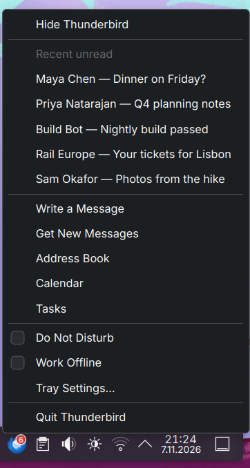
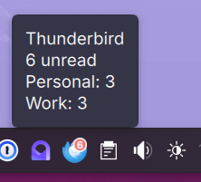
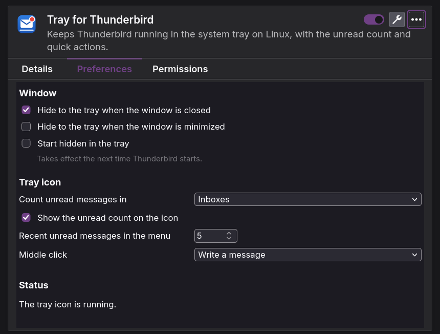

# Tray for Thunderbird

[English](README.md)

Thunderbird'ü Linux'ta sistem tepsisinde çalışır tutar. Pencereyi kapattığınızda Thunderbird kapanmaz,
gizlenir; böylece yeni postalar gelmeye ve bildirimler görünmeye devam eder. Tepsi simgesi kaç iletinin
beklediğini gösterir ve en sık yaptığınız işleri bir tık uzağa getirir.

Thunderbird bu özelliği yalnızca Windows'ta sunuyor. Tray for Thunderbird onu Linux'a, Wayland dahil,
Thunderbird'ü X11'e zorlamadan getirir.

<p>
  
  
</p>

## Özellikler

- **Kapatmak yerine gizle.** Ana pencereyi kapatmak, isterseniz simge durumuna küçültmek de, onu tepsiye
  gizler. Simgeye tıklayınca pencere odaklanmış olarak geri gelir. Menüden ya da Ctrl+Q ile çıkmak
  Thunderbird'ü gerçekten kapatır.
- Simgede **okunmamış sayısı**: gelen kutularında ya da tüm klasörlerde.
- **İpucu:** hesap başına okunmamış ve yeni iletiler, bir posta kutusu %80'in üzerinde dolduğunda uyarı,
  çevrimdışı olduğunuz ya da bildirimleri kapattığınız bilgisi.
- Menüde **son okunmamışlar:** en yeni iletilerin göndereni ve konusu, tek tıkla açılır.
- **Hızlı işlemler:** ileti yaz, yeni iletileri al, adres defteri, takvim, görevler.
- **Rahatsız Etme**, Thunderbird'ün yeni posta bildirimlerini kapatıp açar. Tepsiden **Çevrimdışı Çalış**.
- **Orta tık** isteğe göre ileti yazar ya da yeni postaları alır.
- Thunderbird açılırken **gizli başlama**, örneğin oturum açılışında.
- Thunderbird'ün dilini izler. İngilizce ve Türkçe hazır gelir.

## Nasıl çalışır

İki parça birlikte çalışır: postaları sayan ve pencereyi gizleyen bir Thunderbird eklentisi, ve
Thunderbird'ün native messaging ile kendisinin başlatıp durdurduğu küçük bir tepsi programı. Pencereler
yalnızca onları geri getirecek tepsi simgesi varken gizlenir. Ayrıntılar
[docs/architecture.md](docs/architecture.md) içinde (İngilizce).

## Gereksinimler

- Thunderbird 140 ya da üstü; dağıtımınızın paketi ya da thunderbird.net sürümü. 140 ESR ve 158 ile test edildi.
  Flatpak ve Snap paketleri eklentilerin korumalı alan dışında program başlatmasına izin vermediği için
  tepsi programını çalıştıramaz.
- StatusNotifierItem tepsisi olan bir masaüstü: KDE Plasma (6.8, Wayland üzerinde test edildi), AppIndicator
  eklentisiyle GNOME ve diğerlerinin çoğu.
- Python 3.11 ya da üstü; [uv](https://docs.astral.sh/uv/) ya da [pipx](https://pipx.pypa.io/).

## Kurulum

1. [Son sürümden](https://github.com/kemalasliyuksek/thunderbird-tray/releases/latest)
   `thunderbird-tray-<sürüm>.xpi`, `thunderbird_tray-<sürüm>-py3-none-any.whl` ve `SHA256SUMS` dosyalarını
   indirin; sonra dosyaları doğrulayın, tepsi programını kurun ve Thunderbird'e tanıtın:

   ```bash
   sha256sum --check --ignore-missing SHA256SUMS
   uv tool install ./thunderbird_tray-<sürüm>-py3-none-any.whl   # ya da: pipx install ./thunderbird_tray-…whl
   thunderbird-tray install
   ```

   `thunderbird-tray install`, Thunderbird'e programın yerini söyleyen
   `~/.mozilla/native-messaging-hosts/com.kemalasliyuksek.thunderbird_tray.json` dosyasını yazar. Programı
   yalnızca bu eklenti başlatabilir.

2. Eklentiyi Thunderbird'e kurun. Thunderbird'de **Araçlar › Eklentiler ve Temalar**'ı açın, dişli düğmesine tıklayın, **Dosyadan Eklenti
   Yükle…**'yi seçin ve `.xpi` dosyasını gösterin. Thunderbird, eklentinin Thunderbird'e ve bilgisayarınıza
   tam ve sınırsız erişimi olacağı uyarısını gösterir. Bu uyarı, experiment API'si kullanan her eklentide
   çıkar; bu eklentinin pencereyi gizlemek için buna ihtiyacı var. Eklentinin gerçekte ne yaptığı
   [SECURITY.md](SECURITY.md) içinde anlatılıyor (İngilizce).

3. Thunderbird'ü yeniden başlatın. Simge tepside görünür.

Kurulumu `thunderbird-tray status` denetler.

### Kaynaktan

```bash
git clone https://github.com/kemalasliyuksek/thunderbird-tray.git
cd thunderbird-tray
uv tool install ./host           # ya da: pipx install ./host
thunderbird-tray install
python3 scripts/build-xpi.py     # dist/thunderbird-tray-<sürüm>.xpi dosyasını yazar
```

Sonra `.xpi` dosyasını yukarıdaki 2. adımdaki gibi kurun.

### Oturum açılınca tepside başlatma

Eklenti ayarlarında **Tepside gizli başlat**'ı açın, sonra Thunderbird'ü oturum açılışında başlatın. KDE
Plasma'da: **Sistem Ayarları › Otomatik Başlat › Ekle… › Uygulama Ekle…** ve Thunderbird'ü seçin. Diğer
masaüstlerinde Thunderbird'ün `.desktop` dosyasını `~/.config/autostart/` dizinine kopyalayın. Pencere
çizilmeden gizlendiği için ekranda bir an bile görünmez. Hiç pencere açılmadığından masaüstünün meşgul
imleci zaman aşımına kadar döner; bunu önlemek için otomatik başlatma girdisine `StartupNotify=false`
ekleyin.

## Kullanım

| İşlem | Sonuç |
| --- | --- |
| Simgeye tıklama | Thunderbird'ü gösterir ve odaklar; zaten öndeyse gizler. |
| Orta tık | İleti yazar (ya da yeni postaları alır ya da hiçbir şey yapmaz; ayarlara bakın). |
| Sağ tık | Menü. |
| Pencereyi kapatma | Tepsiye gizler. |

Ayarlar menüde **Tepsi Ayarları…** altında ve Thunderbird'ün eklenti yöneticisinde.



## Sorun giderme

- **`thunderbird-tray status` çalıştırın.** Programı, kaydını, Thunderbird'ü ve tepsiyi denetler.
- **Pencere gizlenmek yerine kapanıyor.** Tepsi programı çalışmıyor; eklenti ayarlarındaki **Durum**
  bölümü bunu gösterir. Kaydı `thunderbird-tray status` ile denetleyin ve eklentinin iletileri için
  **Araçlar › Geliştirici Araçları › Hata Konsolu**'na bakın.
- **Pencere geri geliyor ama diğer pencerelerin arkasında kalıyor.** Thunderbird büyük olasılıkla
  `--no-remote` ile başlatıldı; bu, pencereye odağı veren aktarımı engeller.
- **Hata ayıklama logu.** Thunderbird'ü `THUNDERBIRD_TRAY_DEBUG=1` ortam değişkeniyle başlatırsanız tepsi
  programı gönderdiği ve aldığı her iletiyi `~/.local/state/thunderbird-tray/host.log` dosyasına yazar.
  Log, son postaların gönderenlerini ve konularını içerir.

## Kaldırma

Eklentiyi Thunderbird'ün eklenti yöneticisinden kaldırın, sonra:

```bash
thunderbird-tray uninstall
uv tool uninstall thunderbird-tray   # ya da: pipx uninstall thunderbird-tray
```

## Geliştirme

[CONTRIBUTING.md](CONTRIBUTING.md) dosyasına bakın (İngilizce). İki parça arasındaki protokol
[docs/protocol.md](docs/protocol.md) içinde.

## Lisans

[MIT](LICENSE)
